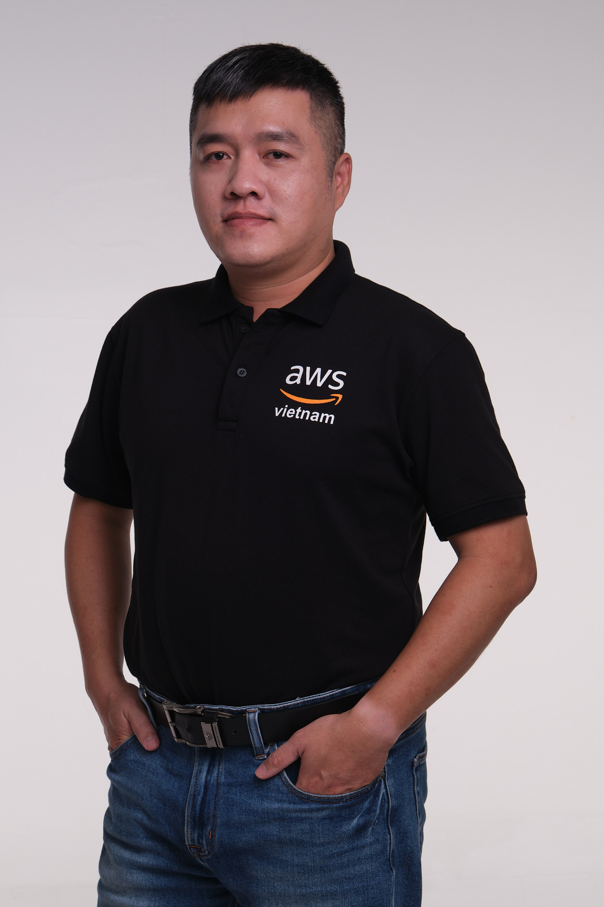
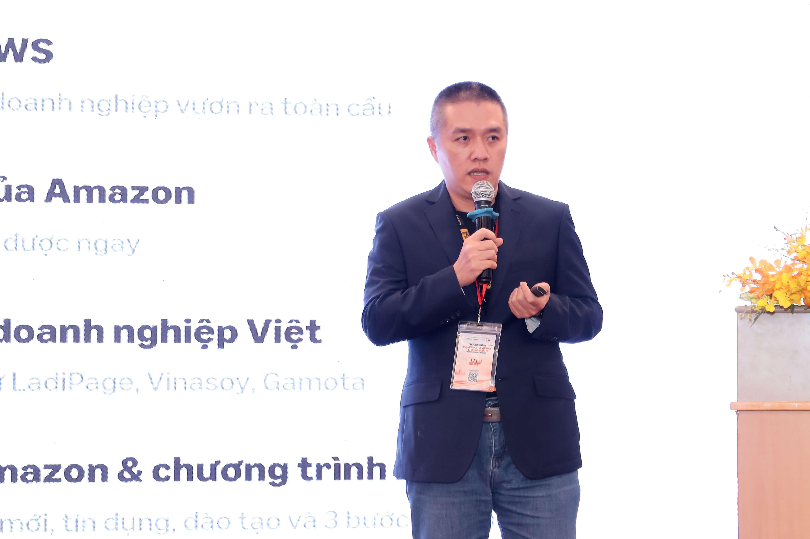
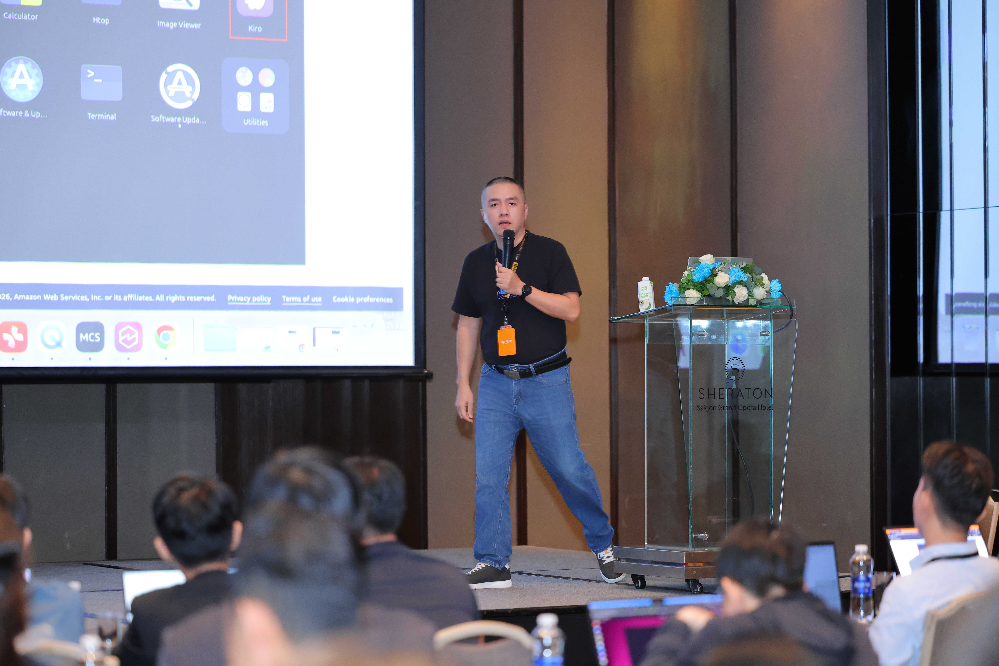

Organizers: feel free to use anything on this page for agendas, websites and announcements — no need to ask.

## Name & title
**Mr. Thi Nguyen Dinh** — Senior Solutions Architect, Generative AI & Agentic Systems
*(Pronunciation: "Tee")* · Please use **Mr.**

## Bio — 1 sentence (for MC)

Thi Nguyen Dinh is a Senior Solutions Architect and AWS Vietnam's GenAI Champion, with 20 years in software and a focus on taking agentic AI from prototype to production.

<button type="button" class="copy-bio" data-target="bio-1sentence">Copy</button>

## Bio — 50 words (for agenda)

Thi Nguyen Dinh is a Senior Solutions Architect and AWS Vietnam's GenAI Champion for the past two years. With 20 years in software — from startup co-founder to principal engineer — he helps companies build agentic AI in production. He has delivered 100+ talks and authored an open-source GenAI repo with 380+ stars.

<button type="button" class="copy-bio" data-target="bio-50words">Copy</button>

## Bio — 150 words (for website)

Thi Nguyen Dinh is a Senior Solutions Architect focused on generative AI and agentic systems, and has been recognized as AWS Vietnam's GenAI Champion for the past two years. Over 20 years in software, he has worked as a developer, co-founded a startup at 24, led engineering teams, and served as a technical architect for fintech and payments platforms.

Today he helps startups and enterprises take agentic AI from prototype to production — covering architecture, evaluation, security and isolation, and cost and latency optimization — and modernize business-critical workloads such as core banking and SAP. His work is featured in public AWS case studies with Katalon and TymeX.

Thi has delivered 100+ talks and workshops, judged and mentored hackathons including Agentic AI Build Week (3,300+ builders, 60+ countries), and maintains AWS-First-GenAI-Journey, an open-source collection of 24 GenAI reference apps with 380+ stars.

<button type="button" class="copy-bio" data-target="bio-150words">Copy</button>

## Photos (high resolution)
Click any photo to open the full-resolution version.

  
  
  

Downloads: [profile.jpg](/images/profile.jpg) · [bio-photo-1.jpg](/images/bio-photo-1.jpg) · [bio-photo-2.jpg](/images/bio-photo-2.jpg) · [Event photos](/talks/)

## Talk topics
- Agentic AI in production: from prototype to multi-tenant platform
- Securing and isolating AI agents (per-session isolation, compliance)
- Governing AI coding tools at enterprise scale
- Context engineering and evaluation for LLM applications
- Modernizing core banking and SAP on the cloud

## Formats
Keynote · technical deep-dive · hands-on workshop · panel · hackathon judge/mentor
Languages: English, Vietnamese

## Contact
[LinkedIn](https://www.linkedin.com/in/ndthi/) · [ndthi@amazon.com](mailto:ndthi@amazon.com)

